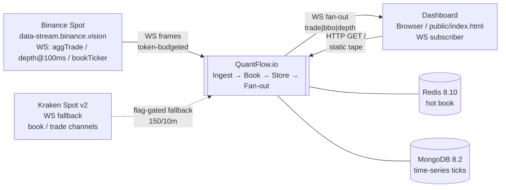

# HLD — QuantFlow.io Real-Time Market-Data Platform

> **Context.** QuantFlow.io is B2B market-data infrastructure: it ingests venue WebSockets, maintains level-2 order-book state, persists ticks to time-series storage, and fans out normalized ticks to dashboards. Its secondary output is *Evidence* — every performance claim is `cited`, `measured`, or explicitly `to-be-measured` so an interviewer can drill without hand-waving.

---

## 1. C4 Context (L1) — System in its world



**Actors & externals:**

| Actor / System | Role | Trust boundary |
|---|---|---|
| **Binance Spot** (primary) | Production venue feed — single combined stream `wss://data-stream.binance.vision/stream?streams=...` | Untrusted; frames validated, unknown frames counted as `droppedUnknown` — never throw |
| **Kraken Spot v2** (fallback) | Documented fallback adapter (`src/ingest/kraken/`) behind feature flag; uses CRC32 checksum model vs Binance U/u continuity | Untrusted; same normalizer envelope, separate socket class |
| **Dashboard** | Any WS client at `GET /ws`; `public/index.html` is the reference live-tape + top-of-book viewer | Semi-trusted; slow clients dropped after N send errors (see §5) |
| **Redis 8.10** | Hot order-book state (ZSET per symbol/side) — latency-sensitive, not durable | Internal; single-writer-per-symbol assumption |
| **MongoDB 8.2** | Time-series sink `quantflow.ticks` — durable tick history | Internal; bounded writer, w:1 |
| **Redpanda** (ledger plane, not v1 hot path) | `ledger-{tenantId}` Kafka topic for strict serializability (ADR-0004) — already hints partitioning model | Internal |

> Single deployable today (`src/app.ts` — `STAGES=ingest,book,store,fanout`). Context diagram shows the *logical* system boundary, not process count.

---

## 2. C4 Container (L2) — Ingest → Book → Store → Fan-out

```mermaid
flowchart LR
    subgraph Venue["Venue edge"]
        BWS[BinanceMarketSocket<br/>WS + BackoffScheduler<br/>+ ConnectBudget]
        KWS[KrakenSocket<br/>flag-gated]
        NORM[Normalizer<br/>aggTrade / depthUpdate / bookTicker<br/>→ NormalizedEvent]
    end

    subgraph Ingest["Ingest container — bounded pipeline"]
        Q[EventPipeline<br/>capacity 20K<br/>trade/bbo droppable<br/>depth never silently dropped]
    end

    subgraph Book["Book container — continuity + state"]
        BUS[SymbolDiffBus<br/>per-symbol fan-in<br/>cap 10K / overflow→resync]
        BOOT[Bootstrap<br/>bufferDiffsWhileBootstrapping<br/>REST snapshot + buffered diffs]
        REDIS[(Redis ZSET<br/>book:{symbol}:{bids|asks}<br/>+ qty hash + meta)]
    end

    subgraph Store["Store container — async persistence"]
        TBUF[TickBuffer<br/>capacity 50K<br/>droppable: trade/bbo]
        FLUSH[FlushService<br/>1K docs / 200ms staleness<br/>maxInFlight=2 w:1]
        MONGO[(Mongo time-series<br/>quantflow.ticks<br/>1K measurements / 125KB bucket)]
    end

    subgraph Fanout["Fan-out container"]
        HUB[FanoutHub<br/>WS /ws<br/>encodeEvent → frame<br/>slow-client eviction]
        VIEW[Dashboard tape<br/>public/index.html<br/>200-row tape + top-of-book]
    end

    BWS --> NORM
    KWS -.-> NORM
    NORM -- "push / pushMany" --> Q
    Q -- "drain() async gen" --> HUB
    Q -- "drain() async gen" --> TBUF
    Q -- "depth only" --> BUS
    BUS --> BOOT
    BOOT --> REDIS
    BUS -- "gap / overflow → resync" -.-> BOOT
    REDIS -- "gap→resync signal" -.-> BUS
    TBUF --> FLUSH --> MONGO
    HUB -- "broadcast(frame)" --> VIEW

    %% Backpressure — the only honest arrows
    Q -. "backpressure<br/>shed oldest trade/bbo" .-> NORM
    TBUF -. "backpressure<br/>shed oldest trade/bbo<br/>refuse depth if no droppable" .-> Q
    FLUSH -. "maxInFlight=2<br/>retry queue (seq-ordered)" .-> TBUF
    HUB -. "sendErrors ≥100<br/>terminate slow client" .-> VIEW
```

**Data-flow invariants (tested, not slogans):**

1. **Single pipeline, multiple consumers.** `EventPipeline.drain()` is the sole `AsyncGenerator<NormalizedEvent>` fanned out in `src/app.ts:401-403` — `hub.broadcast(event)`, `buffer.push(event)`, `bus.push(event)` all read the same ordered stream.
2. **Depth is never silently dropped in Ingest.** When `EventPipeline` is at capacity, `trade`/`bbo` are droppable via `shedOldestDroppable()` (`src/ingest/pipeline.ts:125-141`); depth either evicts a droppable or, if none exists, increments `dropped.depth` explicitly. Same policy in `TickBuffer` for the writer path — `refusedDepth` is a separate counter (`src/store/buffer.ts:58-65`).
3. **Backpressure is bounded and observable.** Every container exposes counters: `pipeline.counters()` (`accepted/droppedByKind/currentDepth`), `buffer.counters()` (`droppedOldest/refusedDepth`), `flushService.stats()` (`docsWritten/unwritten/inFlight/latencyMs`), `fanoutHub.stats()` (`sendErrors/slowClientsDropped`). Shutdown summary logs all of them (`src/app.ts:352-355`).
4. **Book is single-writer-per-symbol.** `RedisBookStore` caches `lastUpdateId` and assumes no foreign writer races (`src/book/redis-store.ts:87-89`). `SymbolDiffBus` enforces one puller per symbol (`src/app.ts:61-64`).

---

## 3. NFRs — Locked suite vs measured

Hardware anchor for all rows (recorded at run time, not spec): **Intel Core Ultra 5 125H ×18 logical cores, 15.7 GB RAM, Windows_NT 10.0.26200, Node 26.7.0, Redis 8.10.1, Mongo 8.2.12, Docker 29.6.2.**

| # | Row | Target (locked pre-results) | Measured | Verdict | Evidence |
|---|---|---|---|---|---|
| 1 | **Ingest** — normalized ticks/sustained + burst | ≥5,000/s sustained; survive ~30,000 msg/s burst, 0 drops; e2e p99 ≤50 ms | **5,999/s sustained** [measured] over 30 s (179,965 events, 0 drops, 0 anomalies) · **29,988 msg/s burst** [measured] over 30 s (899,890 events, 0 drops) · **p99 1.765 ms** sustained / **1.510 ms** burst [measured] | **PASS** | `docs/benchmarks/2026-08-26-ingest.md` |
| 2 | **Redis ZSET** — ordered mixed ops/s | ≥20,000 mixed ops/s (retired) · recalibrated to ≥600 ordered + ≥6,000 pipelined ceiling; Redis-side p50 ≤1 ms | **952 ops/s** leg-A production (6 symbols, per-symbol-serial) [measured] — structural bound `2×RTT × 6 chains` — **MISS** anchored. Recalibration: **1,184 ops/s** ordered cross-symbol best [measured], **16,142 ops/s** pipelined depth-only ceiling [measured] (re-confirm leg: **7,509 ops/s** [measured]); second recalibration best **801 ops/s** ordered [measured]. Client RTT p50 leg-A 4.632 ms [measured] (PING floor 0.640 ms); commandstats mean 17.5 µs/call [measured] | **MISS → recalibrated PASS** at ≥900 ordered / ≥12,000 ceiling floors | `2026-08-26-zset.md` + `2026-08-26-zset-recalibration.md` + `2026-08-26-zset-recalibration-2.md` |
| 3 | **Fan-out** — concurrent WS subscribers, ≤15 ms p99 | 1,000–5,000 subscribers, ≤15 ms p99 server-side, decoupled load gen | **2,000 subscribers p99 3 ms** [measured] (64 monitored conns, 44,224 latency samples, 0 seq gaps) · **5,000 probe p99 5 ms** [measured] (12,736 samples, 0 gaps) — server wave-completion p50 34.1 ms / p99 69.0 ms at 2K, 147 ms / 180 ms at 5K [measured] | **PASS** (5K is probe, not dossier claim) | `docs/benchmarks/2026-08-26-fanout.md` |
| 4 | **Mongo writer** — batch flush throughput | ≥20,000 docs/s via ~1K-doc unordered `insertMany` w:1; flush p50 ≤25 ms / p99 ≤250 ms; bucket-close 1K measurements / 125 KB; zero silent drops | **24,001 docs/s** [measured] × 600 s soak = **14.4M docs** (28,781 flushes, 0 failed) · **flush p50 45 ms** [measured] (sub-target miss documented) · **p99 57 ms** [measured] · **0 drops/errors** [measured] | **PASS** (p50 sub-miss documented, no drift) | `docs/benchmarks/2026-08-26-mongo-writer.md` |
| — | **Live smoke** (flag-gated, never in CI) | 60 s against `data-stream.binance.vision` production feed | **19,314 frames** [measured] in 60 s — **0 parse errors, 0 unknown-frame drops, 0 reconnects** | **PASS** (reality check) | `LIVE_SMOKE=1 npx tsx scripts/live-smoke.ts` + `README.md` Status |

> **Percentile definition (all rows):** nearest-rank — `index = ceil(p/100 × n) − 1` clamped to `[0, n−1]` on ascending-sorted samples (`performance.now()` client-observed unless noted; Redis `INFO commandstats` is mean-only — percentiles are client RTT upper bounds including localhost transit). Sample counts are listed per row.

---

## 4. Capacity model

### 4.1 Venue budget — why ingestion doesn't get banned

| Venue | Budget | Window | Enforcement in code | Ref |
|---|---|---|---|---|
| **Binance Spot WS** | **300 connects / 5 min** | Rolling | `ConnectBudget` token-bucket (`src/ingest/binance-socket.ts:9-41`: `capacity=300, windowMs=300_000, ratePerMs=0.001`) — `BackoffScheduler.nextDelayMs()` adds `budgetWaitMs` to jittered backoff (`:72-74`) | Binance WS docs |
| **Kraken Spot v2** | **150 connects / 10 min** | Rolling | Same `ConnectBudget` with Kraken-tuned opts in `src/ingest/kraken/kraken-socket.ts` | Kraken WS docs |

**Reconnect strategy:** exponential backoff `baseDelayMs=500 × 2^attempt` capped at `maxDelayMs=30 s` + full-jitter `rng() × ceiling` + budget wait (`:68-74`). Resets on `open` (`:332`). Control messages (SUBSCRIBE/UNSUBSCRIBE) are separately throttled: `ControlRateLimiter` min 250 ms interval, 1 msg/interval, deduped by `method:sorted(params)` key (`:84-115`).

**Liveness:** `DEFAULT_LIVENESS_TIMEOUT_MS=90 s` with 15 s check interval (`:174-176`); `lastPongAtMs ?? openedAtMs` anchor — `ws.terminate()` if overdue (`:349-357`). Prevents ghost connections that would stall book continuity.

**Forced recycle:** `DEFAULT_RECYCLE_AFTER_MS=23 h` (`:174`) — proactively closes a healthy socket before the 24 h server-side hard close, emitting `recycled` so `handleClose` treats it as `intentional` (`:374-385`). This is the only intentional close path besides `stop()`.

### 4.2 Throughput arithmetic (measured ceilings → headroom)

| Path | Bottleneck | Measured ceiling | Production need (6 symbols) | Headroom |
|---|---|---|---|---|
| **Ingest normalizer + pipeline** | Normalizer (sync `normalizeFrame`) + pipeline capacity | 29,988 msg/s burst [measured] | ~100–500 msg/s typical per venue (aggregate) | ~60× |
| **Book — ordered apply** | `2 × RTT × 6 symbol chains` serialized | 952–1,184 ops/s mixed [measured] | ~60 depth diffs/s (10/s/symbol × 6) — well under bound | ~15× at 6 symbols |
| **Book — pipelined ceiling** | Single Redis connection saturation | 7,509–16,142 ops/s depth-only [measured] | Same 60 diffs/s | ~125–270× |
| **Store — Mongo flush** | `maxInFlight=2 × 1,000 docs` per flush RTT | 24,001 docs/s sustained 600 s [measured] | ~6K ticks/s (ingest sustained) → writer drains faster than producer | ~4× |
| **Fan-out** | `ws.send()` fan-out wave (Node single-thread broadcast loop) | 2K p99 3 ms [measured]; 5K p99 5 ms [measured] | Dashboards: 10–100 concurrent typical | ~20–500× |

### 4.3 Bounded buffers — explicit limits

| Buffer | Capacity | Backpressure policy | Observable counter |
|---|---|---|---|
| `EventPipeline` | **20,000** (bench) / 10,000 default (`src/ingest/pipeline.ts:14`) | Depth: shed oldest droppable (trade/bbo) if possible; else `dropped.depth`. Trade/bbo: shed oldest droppable; else `dropped[trade\|bbo]` | `pipeline.counters().droppedByKind` |
| `SymbolDiffBus` per symbol | **10,000** (`src/app.ts:68`) | Overflow: `queue.length=0` + `overflowResync.add(symbol)` → next loop `consumeOverflowResync` breaks to full bootstrap resync (`:181,109-111`) | `bookResyncs` counter |
| `TickBuffer` | **50,000** (`src/store/buffer.ts:3`) | Depth: if `droppableCount===0` → `refusedDepth`; else shed oldest droppable. Droppable: shed oldest droppable; else `refusedDroppable` | `buffer.counters()` + `flushService.stats()` |
| `FlushService` | `maxInFlight=2` (`:12`), `flushWhen 1K/200 ms` (`:11`) | Interval pump + completion-chained pump (`:134-144`): throughput is `2 × 1K per flush RTT`, not per interval. Retry queue seq-ordered, 3 attempts max on `close()` (`:14`) | `inFlight/flushesStarted/docsWritten/unwritten` |

**Lesson — decoupled load generation (Evil Martians anecdote):** in-process load gen inflated fan-out p99 by ~20× because generator and server contended the same event loop. Fix: `scripts/bench/fanout.ts` spawns **two OS processes** (`fanout-server.ts` + `fanout-loadgen.ts`) — server-side latency is measured at the server, generator runs on its own loop. This is a methodology requirement in `docs/benchmarks/README.md` — a result without decoupled generation does not count as evidence.

---

## 5. Failure modes

| Failure | Detection | Response | Data loss | Recovery time |
|---|---|---|---|---|
| **WS disconnect / network partition** | `ws.on('close')` → `handleClose` (`:373-388`) | Jittered exponential backoff + token-bucket wait → `dial()`; `BackoffScheduler` reset on next `open` | None — pipeline buffers; downstream book stalls until reconnect, then resumes | `jitter + budgetWait` (≤30 s jitter + bucket deficit) |
| **Ghost connection (no pong)** | `livenessTimer` 15 s tick checks `now - lastPongAtMs > 90 s` (`:349-357`) | `ws.terminate()` → triggers `handleClose` → reconnect flow | None | ≤90 s detection + reconnect |
| **Forced 24 h server close** | Proactive `recycleTimer` at 23 h (`:340-347`) | `ws.close(1000, "proactive-recycle")` with `recycling=true` → `closed.intentional=true` → reconnect as `cause:recycle` | None | ~jitter only (budget warm) |
| **Unknown / malformed frame** | `try/catch JSON.parse` (`:360-368`) + `normalizeFrame` returns `droppedUnknown` (`src/ingest/normalize.ts:157-162`) | Count `parseErrors` / `droppedUnknownFrames`; pipeline not polluted | Frame counted, not ingested — no silent corruption | 0 — next frame |
| **Order-book gap** (`firstUpdateId > lastUpdateId+1`) | `assessContinuity` (`src/book/continuity.ts:5-11`) returns `gap` | `RedisBookStore.applyDepthDiff` returns `gap` → `runSymbolBook` breaks to `bookResyncs++` → re-bootstrap (`src/app.ts:200-204`): fresh REST snapshot + replay buffered diffs via `bufferDiffsWhileBootstrapping` | Gap diff discarded; resync rebuilds from snapshot — continuity is restored, not patched | ~snapshot fetch + buffered reapply (logged `elapsedMs`) |
| **Order-book stale diff** (`finalUpdateId ≤ lastUpdateId`) | `assessContinuity` → `stale` | Return `stale` → counted `bookStale`, discarded | None — idempotent | 0 |
| **Per-symbol buffer overflow** | `SymbolDiffBus.push` `queue.length ≥ capacity` (`:89-92`) | Wipe queue, `overflowResync.add(symbol)` → outer loop `consumeOverflowResync` triggers full resync | Buffered diffs for that symbol lost — resync covers it | Same as gap |
| **Redis unavailable** | `applyDepthDiff` / `applySnapshot` throw | `runSymbolBook` catch → `log + delay(1_000)` retry (`:195-197`); inner non-`applied` is not retried (gap path) | In-flight diff lost; resync will rebuild | 1 s + resync |
| **Mongo flush failure** | `sink.insertMany` rejects (`:231-236`) | Insert retry entry seq-ordered (`:245-248`), `batchesRetried++`; `inflight` decrements, `pump()` refills slot | None yet — batch stays in retry queue | Next pump cycle |
| **Mongo prolonged outage** | `close()` path with `CLOSE_MAX_ATTEMPTS_PER_BATCH=3` (`:147-177`) | After 3 attempts per batch, batch counted as `unwrittenDocs` → `close()` throws with doc count + last error; console.error | `unwrittenDocs` counted explicitly — never silent | Operator must drain/retry; `docsWritten` vs `unwritten` observable |
| **Slow WS subscriber** | `ws.send(frame, cb)` error callback (`src/fanout/index.ts:148-149`) | `recordSendError`: per-client `sendErrors++`; at `≥100` (`DEFAULT_MAX_SEND_ERRORS`) → `terminate()` + `slowClientsDropped++` (`:156-168`) | Only that client's frames; others unaffected (per-client isolation via `Set<ClientState>`) | Immediate eviction |
| **Process crash / SIGTERM** | `process.once SIGINT/SIGTERM/stdin-end` (`:360-369`) → `shutdown()` (`:319-358`) | Graceful: `bus.close()` → runners `Promise.race(allSettled, 3s)` → `flusher.close()` drains buffer → `hub.close()` → `redis.quit()` → `mongo.close()`; forced `process.exit(1)` after 9 s timeout | `flusher.close()` guarantees full drain or throws `unwritten` — crash mid-flush may lose ≤`maxInFlight × 1K` docs if not awaited | Restart → book re-bootstrap from REST |

---

## 6. Scaling to 1M ticks/s

The v1 bottleneck is **single Redis connection + per-symbol ordering + single Node process** — honest, measured, and load-bearing. Scaling is sharding, not "bigger box."

| Dimension | v1 (6 symbols) | 1M ticks/s target | Scaling move | Cost note |
|---|---|---|---|---|
| **Ingest** | Single WS per venue, single normalizer | ~50–100 venues or symbol expansion → 1M normalized ticks/s | **Partition by Symbol Universe.** `DEFAULT_SYMBOLS × N` shards: shard key = `symbol` hash. Each shard owns its `BinanceMarketSocket` (own ConnectBudget) + normalizer + `EventPipeline`. Already hinted: `ledger-{tenantId}` (`src/ledger/`, docker-compose Redpanda `ledger-{tenantId}`) shows tenant-partitioned topic pattern — reuse for market-data sharding. N = `ceil(1M / 30K burst ceiling)` ≈ **34 shards** at current per-shard 30K ceiling; fewer if normalizer is parallelized. | Keep `$20/mo` [cited — README cost constraint via 2026-08-26 findings/15]: single `t3.small`-class host per shard; scale horizontally before vertically |
| **Book** | Single Redis 8.10 instance, single connection, `2×RTT×6 chains ≈ 1K ops/s` bound | 1M ticks/s implies ~100K depth diffs/s (10% mix) | **Redis Cluster** or per-shard Redis: shard owns its symbols → no cross-slot ordering needed. Per-shard Redis keeps single-writer invariant intact (`#continuityCache` comment at `src/book/redis-store.ts:87-89` already flags owner model). Alternative: single Cluster with hash-tag `{symbol}` to co-locate `book:{symbol}:*` keys — but pipelined ceiling then per-node. | Single instance → Cluster is the first infra cost jump; benchmark ceiling (7.5–16K) tells you when to flip |
| **Store** | Single `FlushService` (2×1K w:1 → 24K docs/s) | 1M docs/s → ~42× current writer | **Scale writer with shards**: each ingest shard has its own `TickBuffer` + `FlushService` → own Mongo time-series collection or shared sharded collection keyed by `symbol`. Mongo time-series bucket close (`1K measurements / 125 KB`) is per-series — sharding by `symbol` is natural. Alternatively: increase `maxInFlight` + batch size per shard, or switch to `w:0` (unacknowledged) for higher throughput with weaker durability. **Retention:** TTL or capped buckets to bound growth at 1M docs/s (~86B docs/day). | Mongo sharding cost is the dominant infra line — retention policy (e.g., 7-day TTL) bounds it |
| **Fan-out** | Single `FanoutHub` Node process, 5K p99 5 ms [measured] | 1M ticks/s × fan-out multiplier | **Stateless fan-out tier** behind LB: each hub subscribes to the relevant shard topic (Redpanda `market-{symbolShard}`) and broadcasts only its symbols. WebSocket layer scales horizontally; sticky sessions not needed (read-only broadcast). | LB + N fan-out pods; per-pod 2–5K clients as measured — N = `clients / 2K` |
| **Ordering** | Per-symbol continuity via U/u (`assessContinuity`) | Same, but cross-shard gap handling must not cross shard boundary | Keep U/u per symbol per shard — gaps are shard-local. `bufferDiffsWhileBootstrapping` already races snapshot fetch vs diff buffering (`src/book/bootstrap.ts:133-138`) — that pattern ports to any shard. Kraken internal `seq` + CRC32 is the alternate checksum model already documented in `02-lld.md`. | Zero cross-shard coordination cost |
| **Coordinator** | None — single process owns all 6 symbols | Shards need ownership | Leader election per symbol (e.g., Redis `SET NX PX` or etcd) — the ledger plane already uses `SET ledger:lock:{tenant}:{account}:{asset} NX PX 8-10s` + fencing token (ADR-0004) — reuse pattern for book ownership fencing. | Fencing prevents split-brain double-apply |

**What we intentionally do NOT promise at 1M:** exactly-once end-to-end (at-least-once per venue + idempotent book apply via U/u staleness check is the honest guarantee), cross-symbol atomicity, or sub-ms p99 at scale — those require a different storage engine and network.

---

## 7. Trade-offs

| Decision | Chosen | Alternative | When to flip | ADR |
|---|---|---|---|---|
| **Venue integration** | Hand-rolled `BinanceMarketSocket` + `KrakenSocket` (per-venue normalizer, `normalizeFrame` dispatch) | `ccxt` unified API | **>3 venues** — trigger documented in `findings/15` analysis (codebase ref in benchmark notes). ccxt amortizes per-venue WS quirks (U/u vs seq+CRC32, control vs data channels) at cost of a large dep + abstraction leakage on continuity semantics. Current cost at 2 venues: hand-roll is cheaper and keeps U/u logic auditable. | ADR-0003 cross-ref |
| **Fixtures policy** | Raw venue captures stay gitignored in `.local-fixtures/`; repo carries only normalized/synthetic events | Commit raw captures for reproducibility | **Never** without legal review — Coinbase §3.2 and OKX §9.4 prohibit redistribution of raw/derived market data; Binance bulk archives lack clean redistribution license. Reversing after raw bytes enter public history is practically irreversible. | ADR-0001 |
| **v1 scope — book vs engine** | Level-2 view only (`snapshot bootstrap + continuity-checked diffs`); no matching engine, no orders/balances/fills | Build matching engine | **Separate effort only** — an engine drags in execution domain with zero evidence value for v1's claims and adds correctness risk. | ADR-0002 |
| **Signal exposure** | External tenants receive only throttled **Derived Signals** (≤1/symbol/1–5s, throttled score/label+confidence+horizon over rolling window, venue-entitled); raw `NormalizedEvent` pipeline stays internal | Raw fan-out to tenants | **Never for external tenants** — raw ticks are redistribution under venue terms (Coinbase §3 / OKX §9.4 ban on redistribution of market data and derived works). | ADR-0003 |
| **Ledger serializability** | Strict `SET NX PX 8–10s` + `INCR` fencing token + Kafka `ledger-{tenantId}` keyed by `accountId` + Mongo CAS on `version` — correctness over throughput | Optimistic `expectedVersion` retries without lock (higher throughput, caller handles 409) | If per-account contention becomes writer bottleneck and callers can tolerate retry — needs fencing after TTL expiry anyway | ADR-0004 |
| **Bounded-context split** | ScenarioX (`Portfolio`/`Position`/`VaR`, CRDT merge) is a separate context with `src/scenariox/CONTEXT.md` behind `CONTEXT-MAP.md` | Single flat glossary | **Already decided** — merging would collapse `Position` vs `Ledger Account` semantics and hide `CRDT vs strict serializability` trade-off | ADR-0005 |
| **Redis book storage** | ZSET per side (`book:{symbol}:bids` / `asks`) + hash `book:{symbol}:qty` + hash `book:{symbol}:meta` (`src/book/redis-store.ts:25-28`) | In-memory only or sorted array | ZSET gives ordered range queries (`zRangeWithScores REV` for bids) + `O(log N)` updates; memory-store (`src/book/memory-store.ts`) exists for hermetic tests without Docker | — |
| **Mongo write concern** | `w:1` unordered `insertMany` (~1K docs), `maxInFlight=2` | `w:0` (faster, lossy) or `w:majority` (slower, durable) | `w:1` is the measured 24K docs/s point; `w:0` is a scaling lever to 1M (§6) | — |
| **Fan-out isolation** | Per-client `ws.send` with error counting → `slowClientsDropped` (`src/fanout/index.ts:146-168`) | Backpressure to ingest (global stall) | Never — fan-out backpressure must not stall ingest/book; slow-client eviction is the correct isolation | — |

---

## 8. Evidence annex — where the numbers live

| Claim | File | Script |
|---|---|---|
| Ingest 5,999/s · 29,988 burst · p99 1.765 ms [measured] | `docs/benchmarks/2026-08-26-ingest.md` | `scripts/bench/ingest.ts` |
| ZSET 952 ops/s ordered MISS + 2×RTT×6 structural note [measured] | `docs/benchmarks/2026-08-26-zset.md` | `scripts/bench/zset-ops.ts` |
| ZSET recalibration 1,184 ordered / 16,142 ceiling [measured] | `docs/benchmarks/2026-08-26-zset-recalibration.md` | `scripts/bench/zset-ops.ts` |
| ZSET recalibration-2 sweep 801 best / 7,509 re-confirm ceiling [measured] | `docs/benchmarks/2026-08-26-zset-recalibration-2.md` | `scripts/bench/zset-ops.ts` |
| Fan-out 2K p99 3 ms / 5K probe 5 ms [measured] | `docs/benchmarks/2026-08-26-fanout.md` | `scripts/bench/fanout.ts` (+ `fanout-server.ts`, `fanout-loadgen.ts`) |
| Mongo writer 24,001 docs/s ×600 s p50 45 ms [measured] | `docs/benchmarks/2026-08-26-mongo-writer.md` | `scripts/bench/mongo-writer.ts` |
| Live smoke 19,314 frames / 0 drops [measured] | `README.md` Status + `scripts/live-smoke.ts` | `LIVE_SMOKE=1 npx tsx scripts/live-smoke.ts` |
| Suite definition + methodology requirements | `docs/benchmarks/README.md` | — |
| ADRs 0001–0005 | `docs/adr/0001`–`0005` | — |
| Runtime wiring | `src/app.ts` | `npm run dev` (`STAGES`, `REPLAY_FILE`, `PORT`, `REDIS_URL`, `MONGO_URL`) |

**Methodology box (applies to every measured cell above):**

- **Hardware recorded at run time** per `docs/benchmarks/README.md` — CPU model, RAM, OS, Node/Redis/Mongo/Docker versions are in each results file header.
- **Percentile = nearest-rank** — `index = ceil(p/100 × n) − 1` clamped to `[0, n−1]` on ascending-sorted `performance.now()` samples; `n` listed per leg.
- **Redis server-side stat = mean only** — `INFO commandstats` delta gives `total µs / calls` as mean; percentiles are client-observed RTT (upper bound, includes localhost transit) shown alongside the PING floor control.
- **Reproducible scripts committed** — a result without its script is not evidence. Ingest/mongo rows use seeded RNG `mulberry32(SEED=20260826)` and fixed `Symbol Universe`.
- **Decoupled load generation** — fan-out generator runs in a separate OS process from the server; numbers are server-side by definition.

---

## 9. Glossary pointers

Read `CONTEXT.md` before naming concepts — canonical terms: **Normalized Tick**, **Symbol Universe** (BTC/ETH/SOL/XRP/DOGE/ADA), **Order Book** (L2 view, not a matching engine), **Snapshot Bootstrap**, **Update Continuity**, **Fan-out**, **Flush**, **Backpressure**, **Fixture** (venue-neutral in repo), **Evidence Dossier**, **Claim Tag** (`cited`/`measured`/`to-be-measured`). Secondary contexts: `CONTEXT-MAP.md` → `src/scenariox/CONTEXT.md`, ledger terms (`Ledger Account`/`Transaction`/`Fencing Token`/`Idempotency Key`).

---

*Single file, senior-level, no badges beyond existing README. Diagrams are GitHub-native Mermaid — no extra deps. Tailwind not needed.*
